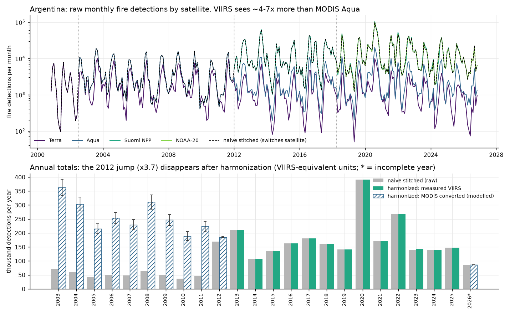
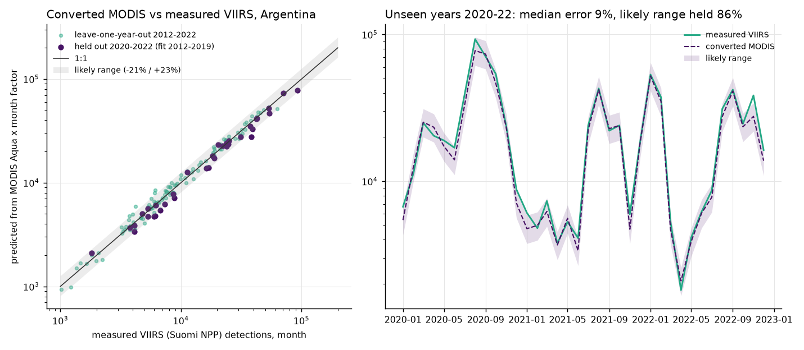
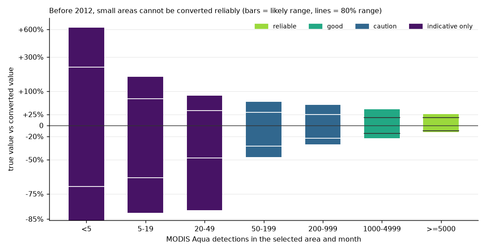

# How we made one fire record out of two satellite families

*Argentina, 2003 to 2026. Team Kubranauts, NASA Space Apps Challenge 2026.*

This document explains what we did, why, and how far the result can be trusted. It assumes no background in remote sensing. What is delivered, what is still open and what comes next are tracked in [SCOPE_AND_GAPS.md](SCOPE_AND_GAPS.md). Source files for every number are given in parentheses, relative to this folder. The full day-by-day investigation is in [findings_log.md](findings_log.md).

Contents: 1 The problem · 2 The data · 3 How the sensors differ · 4 Choosing what to measure · 5 The method · 6 Testing · 7 Uncertainty · 8 Assumptions · 9 Decisions · 10 Using the results · 11 Reproducing · 12 Glossary

---

## 1. The problem in one page

Satellites circling the Earth photograph the ground every day. Software looks at each picture and marks every small square (a *pixel*) that looks hot enough to contain a fire. Each marked pixel is called a **detection** or **hotspot**. NASA publishes them through a service called FIRMS. A fire manager can count detections in a month, compare this August with earlier Augusts, and see whether a fire season is unusually bad. That comparison is what we mean by a **burning-activity calendar**: for each month of each year, is the amount of fire normal, below normal or above normal?

The difficulty is that the detections come from two different cameras, and they do not see the same amount of fire.

- **MODIS** flies on two satellites, Terra (fire data from late 2000) and Aqua (from mid 2002). Each pixel is about 1 km across.
- **VIIRS** flies on Suomi NPP (from 2012) and NOAA-20 (from 2018). Each pixel is about 375 m across, and the camera is more sensitive.

For the same fires on the same days, VIIRS reports several times more detections than MODIS. In Argentina the factor is roughly 4 to 7 depending on the time of year. So if you join the two records end to end, you get a jump that has nothing to do with the ground. In our Argentine data, MODIS Aqua recorded 45,740 detections in 2011, and Suomi NPP recorded 169,182 in 2012, about 3.7 times as many (`data/annual_counts.csv`; `findings_log.md` §1). Argentina did not suddenly burn 3.7 times more. A new camera started counting. A smaller step of the same kind occurs in July 2002, when Aqua joined Terra and the record roughly doubled.

An emergency manager who asked "is this year the worst on record?" from the joined series would be told that every year since 2012 is worse than every year before it. That answer is an artefact.

**Our goal** is one consistent record in which the camera of origin no longer matters. The figure below shows the problem and the result. The top panel is the raw monthly counts by satellite on a log scale. The bottom panel compares the naive joined series (grey) with the harmonized series (colour) year by year.

*What to notice: the grey bars step up by a factor of about 3.7 in 2012 (top: the dashed line leaps when it switches from Aqua to Suomi NPP). After harmonization the 2003 to 2011 bars are hatched, meaning "converted from MODIS", with their likely range as whiskers, and they sit on the same scale as the measured years.*

---

## 2. The data

**What we hold.** We use the FIRMS archive, cleaned into one table where every row is one detection, with the same columns whichever satellite saw it (`../../docs/harmonization_data_brief.md` §3–4). Worldwide the table has about 569 million rows. For this study we extracted Argentina and a rectangle around it: 12.5 million rows, of which 6.45 million are labelled Argentina (`findings_log.md` §0). The country label is reliable: none of the Argentina rows fall outside the rectangle, and 98–100% of the labels come straight from FIRMS.

**The satellites.** Each satellite passes over a given place about twice a day, once in daylight and once at night. Four satellites matter here:

| Satellite | Camera | Pixel at nadir¹ | Argentina data from | Passes in the afternoon at |
|---|---|---|---|---|
| Terra | MODIS | 1 km | Oct 2000 | about 10:15 (morning) |
| Aqua | MODIS | 1 km | Jul 2002 | about 13:50 |
| Suomi NPP | VIIRS | 375 m | Jan 2012 | about 13:50 |
| NOAA-20 | VIIRS | 375 m | Apr 2018 | about 13:50 |

¹ *Nadir* means straight below the satellite; pixels grow towards the edge of the picture. Argentina dates: `findings_log.md` §0. Overpass times: §5a.

A fourth VIIRS satellite, NOAA-21, exists but is not loaded.

**Filters we apply.** We count a detection only if FIRMS classes it as a *vegetation fire* (not a volcano, a gas flare, an industrial heat source or a platform at sea) and its *confidence* is not "low". Confidence is a label the FIRMS software puts on each detection. The filters remove different amounts from each sensor, which already affects comparisons (`findings_log.md` §0, science-quality data only):

| Satellite | Not vegetation | Low confidence | Kept |
|---|---|---|---|
| Aqua | 1.28% | 4.19% | 94.71% |
| Terra | 2.96% | 5.77% | 91.86% |
| Suomi NPP | 3.07% | 8.73% | 88.28% |
| NOAA-20 | 3.37% | 9.18% | 87.55% |

The filter takes about 12% of VIIRS detections but about 5% of Aqua's. That alone moves the VIIRS-to-Aqua ratio by about 7%. So the conversion must be measured with the same filter that is used in production, and it is.

**Science quality versus near real time.** FIRMS first releases data quickly (*near real time*, NRT) and replaces it with refined *science quality* (SP) data some months later. The newest months of 2026 are NRT. Our calendar marks them as provisional.

**Missing days.** On 158 satellite-days no data arrived at all, or far less than normal (`findings_log.md` §5a; table `gaps` in `data/argentina.duckdb`). Examples: Suomi NPP 2024, 19 missing days; Aqua 2022, 16; Terra 2001, 17. A missing day is not a day without fire, and we never treat it as zero (see section 5).

---

## 3. What actually differs between the sensors

We measured the relationship between the cameras on the years when both were flying. Three things matter.

**Pixel size and sensitivity.** A VIIRS pixel has about one seventh the area of a MODIS pixel (median size 0.44 km against 1.3 km; `findings_log.md` §0). A small fire that fills part of a VIIRS pixel can vanish inside a MODIS pixel. A big fire lights up many VIIRS pixels but only a few MODIS pixels. So the ratio depends on the size of the fires.

**Season.** In Argentina the VIIRS to Aqua count ratio, by calendar month, runs from about 4.2 in July and August to about 6.7 in November to February (pooled 2012 to 2022; `findings_log.md` §2). The burning season peaks in August and September, when fires are large and the pixel-size effect is weakest. In the green season the fires are small agricultural burns that VIIRS sees and MODIS often misses. The ratio is stable for any given calendar month: from year to year its logarithm varies with a standard deviation of only 0.07 to 0.18 (§2). That stability is what lets us correct for it.

**Day versus night.** Aqua flies over at about 01:15 at night, and VIIRS at about 01:05, almost the same time. Yet only 7.5% of Aqua's detections are at night, against about 27% for VIIRS (`findings_log.md` §0). VIIRS is far better at spotting small cool fires in the dark. The night ratio is about 20, the day ratio about 4 (§2).

**Region.** Over the four large zones we used, the ratio lies between 4.96 and 6.22 (north-east 5.14, north-west 4.96, centre 5.65, south 6.22; §2). It varies more over small areas: at 2-degree blocks (roughly 200 km) the ratio ranges from 2.2 to 25.

**Orbit drift.** Satellites do not hold their orbit forever. Aqua's afternoon pass has slid later each year since 2022: its median daytime overpass was 13.9 h through 2022, then 14.2 h (2023), 14.5 h (2024), 15.1 h (2025) and 15.8 h (2026). Terra's morning pass has slid earlier: 10.2 h until 2021, then 8.65 h in 2026 (`findings_log.md` §5a). Fire follows a daily cycle and peaks in mid-afternoon, so a camera that passes at a different hour sees a different amount of fire. VIIRS stays fixed at about 13.8 h. After 2022 the MODIS record is no longer a stable measuring stick.

**Two satellites of the same camera agree.** Suomi NPP and NOAA-20 give nearly identical counts on days when both have data (ratio 1.025; `findings_log.md` §2), so we treat them as one VIIRS record and switch between them without a correction.

**Bad days and strange cells.** The largest single days in the record are real fire events (Aug 2003, Sep 2013, late Sep to Oct 2020) and not artefacts. One caveat remains. Some places show "fire" on 200 or more days of the year: 937 cells (0.1 degree squares) for Suomi NPP, about 30% of its detections. Most are real, for example the sugar-cane belt in Tucumán that burns every year. But the most active cell, in the Vaca Muerta oil field in Neuquén, was active on 1,021 days and is probably a gas flare that FIRMS labelled as vegetation (`findings_log.md` §4c). Section 6 shows this does not change the result materially.

---

## 4. Choosing what to measure

"Fire activity" can be measured in several ways. Before building anything, we compared three on the period 2012 to 2019 only, when MODIS (Aqua) and VIIRS (Suomi NPP) both flew and had no drift. We deliberately looked at nothing after 2019 while choosing, so the later years stay a fair test.

1. **Detection count:** the number of hotspots in the month.
2. **Active cell-days:** divide the map into 0.1-degree squares, then count each square-day with at least one detection. This lessens the pixel-size effect, because 20 neighbouring VIIRS hits count once.
3. **Fire radiative power (FRP):** the heat energy each fire gives off, in megawatts, summed over detections. The total FRP is nearly the same for both cameras (ratio about 1.0), so it looks attractive.

We scored each on three questions (`findings_log.md` §3):

- *Residual spread:* after applying the best monthly factor, how much is left unexplained? Lower is better.
- *Slope:* on a log-log plot, is the relation a straight line of slope 1? A slope of 1 means a plain scale factor is the right correction.
- *Anomaly agreement:* does converted MODIS put a month in the same class (below normal, normal, above normal) as measured VIIRS? (Counts also scored best on this on the selection years; those agreement figures are in `findings_log.md` §3 and are in-sample, so we do not quote them here.)

| Whole country, day+night | Residual spread | Slope |
|---|---|---|
| **Detection count** | **0.095** | **0.99** |
| FRP | 0.173 | 0.87 |
| Active cell-days (0.1°) | 0.136 | 0.85 |

(`findings_log.md` §3.) Counts won at country and zone scale. At 2-degree blocks cell-days had a slightly lower residual (0.498 against 0.552), but no quantity converts well at that size: in 13% of block-months Aqua saw nothing while VIIRS saw fire. FRP is heavy-tailed: a few huge detections dominate a month's total. Cell-days saturate: in a big month VIIRS adds fewer new cells per MODIS cell, so a constant factor would overestimate extremes. We therefore chose the plain **count of fire detections, day and night, per month**, expressed in **VIIRS-equivalent units**: "how many hotspots one VIIRS satellite would have reported." That makes the unit easy to explain, and VIIRS is the camera that continues into the future, because MODIS is due to stop in 2027 (`../../docs/harmonization_data_brief.md` §2).

Our project brief had suggested that FRP and cell-days might calibrate better than counts. In Argentina they did not (`findings_log.md` §X).

---

## 5. The method, step by step

### 5.1 The idea

For any given calendar month, VIIRS counts a fairly constant multiple of what Aqua counts. We measure that multiple over the years when both flew, then multiply the older Aqua counts by it.

### 5.2 The factor

For each calendar month (January to December) we add up all VIIRS (Suomi NPP) detections and all Aqua detections over the eight fit years 2012 to 2019, using only days on which both satellites had good data. The factor is the VIIRS total divided by the Aqua total. That is 12 numbers in all (`data/11_month_factors.csv`, `gold/gold_calibration.parquet`):

| Month | Jan | Feb | Mar | Apr | May | Jun | Jul | Aug | Sep | Oct | Nov | Dec |
|---|---|---|---|---|---|---|---|---|---|---|---|---|
| Factor | 6.53 | 6.67 | 6.18 | 5.52 | 4.70 | 4.13 | 4.00 | 4.16 | 5.00 | 5.56 | 6.20 | 6.59 |

### 5.3 Putting the series together

| Period | What we show | Label |
|---|---|---|
| 2003-01 to 2012-01 | Aqua count × factor for that calendar month | modelled |
| 2012-02 to 2018-03 | Suomi NPP, measured | observed |
| 2018-04 to 2026-07 | NOAA-20, measured | observed |
| 2026-08 onwards | NOAA-20, near real time | provisional |

Some details:

- **Why the calendar starts in 2003.** Before July 2002 only Terra flew, and Aqua's first months were a start-up period. A Terra-based conversion works (it was tested) but with wider errors, and we left it out of this first version. Terra can be bridged later (`findings_log.md` §5; SCOPE_AND_GAPS gap list).
- **Why January 2012 is modelled.** Suomi NPP data starts on 20 January, covering 12 of the month's 31 days. We require at least half of a month's days to be valid, so January 2012 is converted from Aqua.
- **Why MODIS is not converted after 2022.** Aqua's drift (section 3) breaks the relationship: on unseen years 2023 to 2025, the monthly conversion error swings from about −10 to −25% in 2022 and 2023 to +10 to +35% in 2024 and 2025 (`findings_log.md` §5). For these years we use VIIRS only, which is possible because VIIRS has been measured directly since 2012.
- **Gap days.** Each month's count is divided by the fraction of valid days. If Aqua is valid on 27 of 30 days (coverage 0.9), we scale the count by 1/0.9. We also record the coverage in the table so users can see it. The most recent, incomplete month is not scaled up to a full month; it is marked incomplete and gets no anomaly.
- **When MODIS saw nothing.** If the selected area has zero Aqua detections in a month, we do not report zero. In 96% of such cases VIIRS did see a few fires (median 3), which no factor can recover from zero. The month is marked `insufficient_data` and left blank (`findings_log.md` §5).

### 5.4 A worked example: September 2010

Aqua counted 7,895 filtered detections over Argentina in September 2010 (all days valid, so coverage is 1.0).

- Over September in 2012 to 2019, Aqua counted 54,377 and Suomi NPP 272,111 on matched days. The factor is 272,111 ÷ 54,377 = 5.004 (`gold/gold_calibration.parquet`).
- Harmonized value: 7,895 × 5.004 = **about 39,508 VIIRS-equivalent detections**.
- Likely range (section 7): from −20.9% to +23.2%, so **31,233 to 48,664**.
- For comparison, the median September over 2003 to 2022 is 40,113. The ratio is 0.985, so September 2010 is "normal" (`gold/gold_region_monthly.parquet`, region `argentina`).

### 5.5 Anomalies

For each month we compare against the same calendar month in other years: the median and the mean of 2003 to 2022 on the harmonized series is the default baseline. A second baseline uses measured VIIRS only (2012 to 2025). The app can switch between them. A month is classed by its ratio to the median: below 0.5 is "much below", below 0.8 "below", up to 1.2 "normal", up to 1.8 "above", and higher "much above" (these thresholds are those already used by the app, `scripts/build_sample_gold.py`).

---

## 6. How we tested it

A model that is checked on the same data it was fitted to will always look good. We therefore tested on years the factors had never seen (`11_method_test.py`, `findings_log.md` §5).

**Test 1: fit 2012 to 2019, predict 2020 to 2022.** We fitted the factors on 2012 to 2019, then converted Aqua for 2020, 2021 and 2022, and compared the result to what VIIRS actually measured. Those years are before the drift, so they test the method without that complication. Whole-country results:

| | Single global factor | **Month factors (our method)** |
|---|---|---|
| Median monthly error | 16.5% | **9.5%** |
| 90th percentile monthly error | 37% | **19%** |
| Worst annual error | 17.9% | **8.9%** |
| Average bias | −13.3% | −7.2% |

Half of the converted months were within 9.5% of the measurement, nine out of ten within 19%, and annual totals within 9%. The bias of −7% means the conversion came out low on average in these years.

**Test 2: after the drift.** Applying the same factors to 2023 to 2025 gives an average error near zero (−0.7%), but only because opposing errors cancel, as described above. This is the reason we never convert MODIS after 2022.

**Test 3: leave one year out (LOYO).** For each of 2012 to 2022 in turn, we fitted the factors on the other ten years and predicted the left-out year. This gives a spread of errors for building the uncertainty range in section 7. The monthly log-error standard deviation was 0.116.

**Same factors, second VIIRS satellite.** The factors fitted against Suomi NPP predict NOAA-20 just as well (median error 9.1%), so one factor set serves both.

**What we tried that did not help** (`findings_log.md` §5):

- Separate factors per zone (north-east, north-west, centre, south): no improvement at country level, and mixed within zones.
- Separate day and night factors: worse (error measure 0.142 against 0.135). The night factors, 13 to 46, are unstable.
- We did not try a more flexible statistical or machine-learning model. Where the method fails (small areas, months where MODIS saw nothing, drift), the missing information is not in the MODIS data, so extra MODIS-based inputs would not fix it.

**Two last checks during the build** ([MVP_LOG.md](MVP_LOG.md), `data/13_mvp_checks.txt`):

- *Possible gas flares.* Refitting without the Vaca Muerta area changes the factors by 1.7% on average (at most 3.2%), and the test errors are unchanged (median error 9.4% against 9.5%). We kept the data as is. Removing every cell active on 200 or more days takes out 31% of VIIRS (mostly real farm fires) and gives mixed results, so it is not recommended.
- *Day only.* Using daytime detections alone gives a median error of 8.7% against 9.5%, but worse 90th-percentile (21.5% against 19.0%) and annual (9.5% against 8.9%) errors. Day plus night stays the default.

**Anomaly agreement.** On the held-out years 2020 to 2022, using the calendar's own five colour classes, converted MODIS and measured VIIRS put a month in the same class 89% of the time for the whole country (`data/14_build_gold.txt`, `gold_accuracy`). Agreement is lower for smaller areas, which is what the reliability flags in section 7 are for. Earlier agreement figures from the selection years (`findings_log.md` §3) are in-sample and are not quoted here.

*What to notice: on years the factors never saw (dark points and the dashed line), converted MODIS follows measured VIIRS closely, but stays slightly low. The shaded band is the likely range explained in the next section.*

---

## 7. How uncertain it is

**The likely range.** Every modelled month carries a range around its value. We first built an 80% interval from the leave-one-year-out errors. On unseen years it contained the true value only 67% of the time in 2020 to 2022 and 64% in 2023 to 2025: too narrow. The reason is that errors in neighbouring months of the same year are linked, and a month-by-month calculation ignores that. The wider 95% interval contained the true value 86% of the time in both periods. Rather than tune it further, which would fit the test years, we use that 95% band and describe it as a **likely range with about an 85% chance of containing the true value, measured on years the method had not seen**. For the whole country the monthly range runs from 21% below to 23% above the converted value (`gold/gold_calibration.parquet`; the earlier findings log rounded this to −20%/+25%; the shipped figure is −20.9%/+23.2%, see D-10 in [SCOPE_AND_GAPS.md](SCOPE_AND_GAPS.md)). For a whole year it is about −8% to +8% (`data/14_build_gold.txt`).

**Small areas.** The same conversion is much less precise for small areas, because there are few detections and chance dominates. A user can pick any area in the app, so the range depends on the size of that area. We measured it on the large zones and 2-degree blocks, grouped by the number of Aqua detections in the area and month (`data/11_uncertainty_by_count.csv`, `gold/gold_reliability.parquet`):

| Aqua detections in the area-month | Likely range (true vs converted) | Flag |
|---|---|---|
| 5,000 or more | −12% to +25% | reliable |
| 1,000 to 4,999 | −23% to +38% | good |
| 200 to 999 | −32% to +52% | caution |
| 50 to 199 | −48% to +62% | caution |
| 20 to 49 | −82% to +82% | indicative only |
| 5 to 19 | −83% to +169% | indicative only |
| fewer than 5 | −85% to +626% | indicative only |

The flag follows the half-width of the range: up to 30% is *reliable*, up to 40% *good*, up to 65% *caution*, and beyond that *indicative only*. These cut-offs are our choice, picked to match the table above; they are not a standard. Months measured directly by VIIRS (from February 2012) are always reliable, whatever the area size. The flags only apply to modelled months.

*What to notice: the bars (likely range) shrink quickly as the area contains more MODIS detections. Below about 50 detections the converted value is only a rough indication.*

**What the user sees.** Modelled months are drawn differently from measured ones, each value comes with its range, the reliability flag appears with a plain suggestion (for example "select a larger area or use the seasonal or annual view"), and the accuracy panel states the test results in sentences. The app shows all of this on four pages, in this order in the nav: [The problem](../../web/problem.html) (raw against harmonized; also the landing page), [Fire calendar](../../web/regions.html) (calendar per region with the flags, ranges and baseline toggle; the region buttons are on this page, there is no header picker), [Draw an area](../../web/draw.html) (the same for a shape you draw, with the flag computed from the area's MODIS count) and [How accurate is it?](../../web/accuracy.html) (the test results and the reliability table). The older Map, Calendar, Overview, Year, Briefing and Words used pages are hidden from the nav (files kept, see D-23 in SCOPE_AND_GAPS.md). In the calendar, converted months are hatched, measured months are solid, and a small marker shows "!" for caution and "?" for indicative only. Provisional months and the month in progress show their value with a dashed outline and a "P", and no colour, percentage or rank, because near-real-time data can still change. Local preview: `python scripts/dev_server.py` (port 8788) or `npx wrangler pages dev web`. Do not run two servers on the same port.

---

## 8. What we assumed and what we could not test

We would rather say this directly than leave a reader to find it.

- **The 2003 to 2011 accuracy is assumed from the overlap years.** There is no VIIRS data before 2012, so nobody can check those conversions against truth. We test on 2020 to 2022 and assume the relationship held earlier. It may not have: the largest sources of doubt are listed below.
- **The ratio drifts slowly and we do not know why.** The year-by-year bias moves from about +8 to +10% (2015 and 2016) to −4 to −6% (2020 to 2022) (`findings_log.md` §5). With eight fit years we cannot say whether this is fire regime, a processing change, or chance. Pre-2012 values may carry a level error of 5 to 10% that the likely range covers only in part.
- **MODIS processing changed.** The FIRMS files label MODIS data version 6.2 up to 2017, 6.03 for 2018 to 2022, and 61.03 for 2023 to 2025. The VIIRS-to-Aqua ratio is 6.6% higher in 2018 to 2022 than in 2012 to 2017, but we found no step at 2018 itself, so there is no clear evidence of an algorithm change. We have not checked this against FIRMS documentation (`findings_log.md` §4a). Open.
- **Gas flares.** Some oil and gas flares in the west are probably counted as vegetation fires, which inflates VIIRS slightly there. The effect on the factors is under 3% and we made no correction.
- **Fit set size.** Only eight years went into the factors, and 2020 was an extreme fire year. The factors are weakest in quiet months (April to June); the test error is largest there (for example about 10.8% in April against 3.1% in September; `gold/gold_calibration.parquet`, based on only three test months each).
- **Near-real-time data.** The newest months (August 2026 onwards) are provisional and get no comparison with earlier years. October 2026 is very low (about one fifth of a usual October after harmonization). We tested whether that is a data-coverage artefact (`16_october_check.py`, `data/16_october_check.txt`). It is not: all three satellites that report in October have all 31 days of valid data, and each shows detections per valid day below every earlier October (MODIS Aqua 31 against a past minimum of 45 and a median of 130; Terra 16 against 31 and 93; NOAA-20 144 against 262 and 561). September 2026, also near-real-time, is above September 2025, so near-real-time data is not low across the board. Verdict: a real low, on provisional data that can still be revised when science-quality data arrives. We cannot rule out a processing effect that is specific to NRT October data.
- **Missing satellite days.** A few months with missing days may be overstated by up to about 10% (NOAA-20 February 2024 about +10%, July and September 2023 about +6%; Aqua March and May 2003 about +2 to +4%): detections on flagged gap days are counted and the month is then also scaled up for those days (`SCOPE_AND_GAPS.md` G-28, fix in Future Scope).
- **Zones are rough.** The sub-regions are latitude-longitude boxes, not provinces or ecosystems.
- **Only Argentina.** We have not shown the same method works elsewhere.

---

## 9. Key decisions and why

A fuller, dated list is in the decisions log of [SCOPE_AND_GAPS.md](SCOPE_AND_GAPS.md).

| Decision | Alternatives | Reason | Evidence |
|---|---|---|---|
| Count detections | FRP, active cell-days | Least unexplained spread, slope 0.99, best anomaly agreement | `findings_log.md` §3 |
| One factor per calendar month | One global factor; zone × month; day/night split | Halves the error of a global factor; the others add nothing | §5 |
| Day plus night | Day only | Not clearly better | `data/13_mvp_checks.txt` |
| Fit on 2012 to 2019 | Fit on 2012 to 2022 (to use more years) | The reported errors describe the factors actually used | `14_build_gold.py` |
| No MODIS conversion after 2022 | Convert as far as possible | Orbit drift swings error −25% to +35% | §5 |
| Calendar starts 2003 | Include Terra back to 2000 | Keeps the first version simple | §5, SCOPE_AND_GAPS |
| Show a "likely range" of about 85% | The nominal 80% or 95% interval | The nominal ones under-covered on unseen years | §5 |
| Two baselines | One | Lets the user choose between the long harmonized record and the pure VIIRS era | `gold/README.md` |
| No flare mask | Mask Vaca Muerta or all persistent cells | Effect under 3% | `data/13_mvp_checks.txt` |

---

## 10. How to use the results

**Reading the calendar.** Each month of each year is coloured by how it compares with the same month in other years: much below, below, normal, above, much above. A rank ("3 of 24") and a percentile are given. These compare *activity levels*, not the area burned and not the number of separate fires. One large fire can produce thousands of detections.

**Reading the flags.**

- Solid (measured) months from February 2012 can be taken at face value for their size.
- Hatched (modelled) months come with a range. Look at the flag. A "reliable" modelled month for the whole country has roughly a ±20% uncertainty. An "indicative only" month does not support any conclusion.
- Provisional months can change.

**What you can conclude.** That a month was far above or below normal, in a large area; that a season peaked early or late; that a decade-long trend exists, when large areas and many years are involved.

**What you should not conclude.**

- That one pre-2012 month in a small area was exactly some number.
- That 2003 to 2011 values can be compared to the decimal with 2012 to 2026 values: a difference of a few percent is within the method's accuracy.
- That fewer or more detections means fewer or more fires on the ground without checking the flags. Cloud, satellite drift and data gaps all affect counts.
- Anything about places other than Argentina.

---

## 11. Reproducing it

Run from `harmonization/argentina/`, using the repository's Python environment. Steps 1 to 4 need the cloud-storage credentials (environment variables, never in code).

1. Data layers (earlier in the pipeline): `pipeline/bronze/` downloads the yearly FIRMS files and the 2026 API pulls, `pipeline/silver/build_silver.py` cleans them into one detection table, both in the `firms-data` bucket.
2. `02_extract.py`: cut Argentina out of the silver table (about 6 minutes).
3. `05_build_local.py` and `07_build_daily.py`: build the local database `data/argentina.duckdb` (counts per day, cell and satellite, and the gap-day list).
4. Investigation scripts `01` to `12` (profile, coverage, relationships, comparison of what to measure, method test) produce the logs in `data/` and the plots in `plots/`.
5. `13_mvp_checks.py`: the gas-flare and day-only checks.
6. `14_build_gold.py`: the factors, the series, the ranges and baselines. It writes the gold tables to `gold/*.parquet`. The schema is in [gold/README.md](gold/README.md).
7. `../../scripts/export_calendar.py`: turns the gold tables into the JSON the website reads (`--local gold` to test without the cloud).
8. `15_pitch_figures.py`: the four figures.
9. `../../scripts/verify_app_data.py`: 47 checks on the published tables (recompute from raw, consistency, known events, boundaries, published figures). Run it after every data change: `python scripts/verify_app_data.py` (local JSON) or `--url <site address>` (what the site serves).

The 12 factors and the held-out error figures can be reproduced in a minute from `data/argentina.duckdb`.

---

## 12. Glossary

- **Anomaly:** how far a month is from what is usual for that calendar month in other years.
- **Aqua, Terra:** the two satellites carrying MODIS.
- **Baseline:** the set of years that defines "usual".
- **Calendar-month factor:** the multiplier that converts a MODIS count into a VIIRS-equivalent count for a given month.
- **Confidence (low / nominal / high):** a label the FIRMS software attaches to each detection; we drop "low".
- **Coverage:** the fraction of days in a month with valid satellite data.
- **Detection / hotspot:** one pixel flagged as containing fire.
- **Drift (orbit):** the slow change in the time of day a satellite passes over.
- **FIRMS:** NASA's Fire Information for Resource Management System, the source of the data.
- **FRP (fire radiative power):** the heat energy released by a fire, in megawatts.
- **Held-out years:** years deliberately kept out of the fitting, used only to test.
- **In sample:** measured on the same data used to build the method (flatters it).
- **Leave-one-year-out (LOYO):** fit without one year, predict it, repeat for every year.
- **Likely range:** the interval around a converted value that had about an 85% chance of containing the truth on held-out years.
- **MODIS:** the older camera (1 km pixels), on Terra and Aqua.
- **NRT / SP:** near real time (quick, provisional) and science quality (refined) data.
- **Pixel:** one square of the satellite image.
- **Provisional:** a month that is based on NRT data and may change.
- **Reliability flag:** reliable / good / caution / indicative only; how much a modelled value can be trusted, based on the size of the area.
- **Static source:** a heat source that is not a vegetation fire (volcano, gas flare, industry).
- **Suomi NPP, NOAA-20:** the two satellites carrying VIIRS in this record.
- **VIIRS:** the newer camera (375 m pixels).
- **VIIRS-equivalent:** expressed as the count one VIIRS satellite would have reported.
